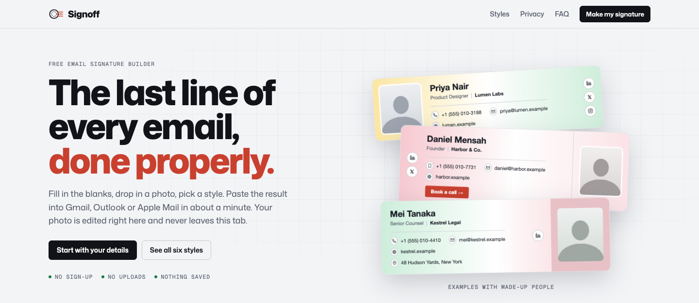
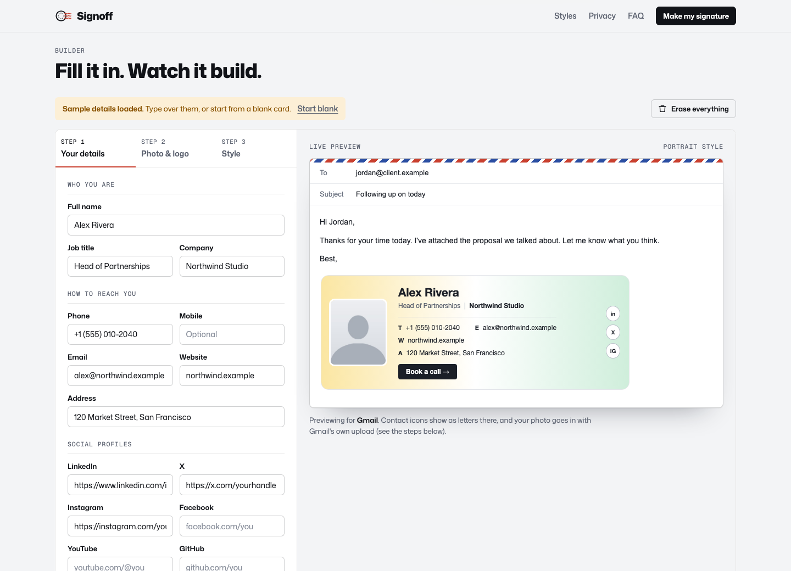
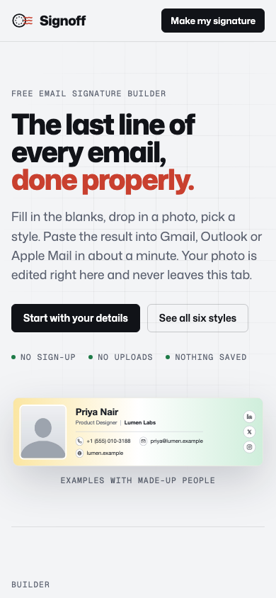
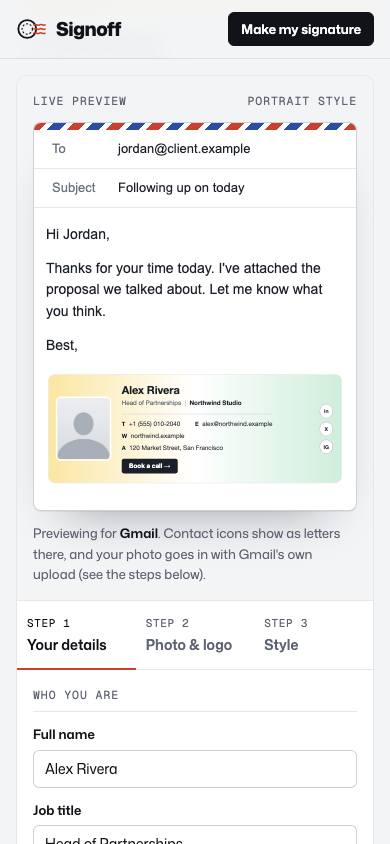
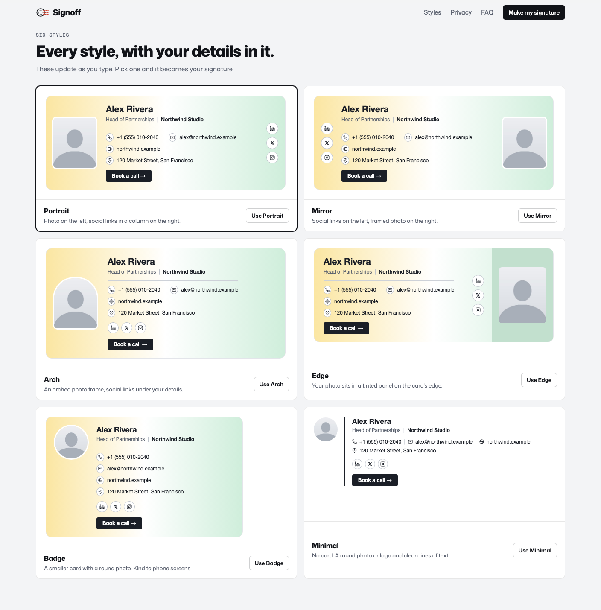
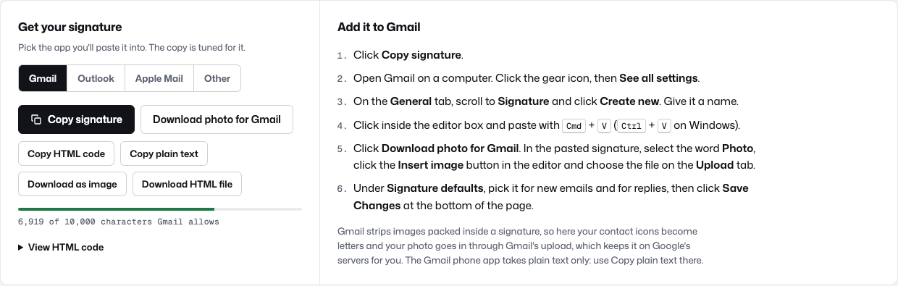
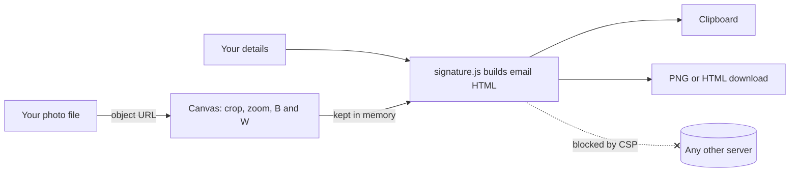

<p align="center">
  
</p>

<h1 align="center">Signoff</h1>

<p align="center">
  <b>A free, private email signature creator.</b><br>
  Fill in the blanks, drop in a photo, pick a style, paste it into Gmail, Outlook or Apple Mail.<br>
  Your photo is edited inside your browser and never leaves it.
</p>

<p align="center">
  
  
  
  
</p>

<p align="center">
  <a href="#run-it-locally">Run it locally</a> ·
  <a href="#features">Features</a> ·
  <a href="#six-styles">Styles</a> ·
  <a href="#add-it-to-your-email-app">Email apps</a> ·
  <a href="#privacy-and-how-its-enforced">Privacy</a> ·
  <a href="#how-it-works">How it works</a> ·
  <a href="#faq">FAQ</a>
</p>

<p align="center">
  
</p>

---

## Why Signoff

Most signature generators ask you to upload your headshot so they can host it on their servers. Many also want an account, an email address, or a subscription before they let you copy the result.

Signoff is a single static page. There is no backend, no account and no tracking. You type your details, the photo is cropped on a `<canvas>` in your own tab, and the finished signature goes to your clipboard or your Downloads folder. Close the tab and it is gone.

## Features

**Build**
- Fill-in-the-blanks form: name, job title, company, phone, mobile, email, website, address
- Six social links: LinkedIn, X, Instagram, Facebook, YouTube, GitHub
- An optional call-to-action button (for example "Book a call") and small print / disclaimer
- Live preview inside a mock email, so you see it the way your reader will
- Sample details to start from, or a blank card

**Photo and logo**
- Drag and drop or pick a file
- Drag to frame your face, zoom from 1x to 3x, keyboard controls too (arrows, `+`, `-`)
- Black and white or color
- Logo upload, shown next to your company name
- Already host your images? Paste their links instead

**Style**
- 6 layouts: Portrait, Mirror, Arch, Edge, Badge, Minimal
- 8 backgrounds (7 pastel gradients and plain white), or a gradient from any two colors you pick
- 6 accent colors plus a color picker for the button and highlights
- 4 email-safe fonts: Helvetica, Georgia, Verdana, Trebuchet
- Contact icons or letters

**Export**
- **Copy signature**: rich HTML ready to paste into your email settings
- **Copy HTML code** and **Copy plain text**
- **Download as image** (sharp 2x PNG) and **Download HTML file**
- **Download photo for Gmail**: your cropped photo with the frame shape baked in
- Output tuned per app: Gmail, Outlook, Apple Mail, or other
- A live counter for Gmail's 10,000 character signature limit
- Step-by-step setup guide for each email app, right under the buttons

**Privacy**
- Nothing is uploaded, stored or tracked. No cookies, no `localStorage`
- A Content-Security-Policy makes the browser refuse any request to another server
- **Erase everything** button, plus an offer to erase after every download

## Run it locally

You need nothing but a browser. Pick whichever way suits you.

### Option 1: `npm start` (recommended)

Requires [Node.js](https://nodejs.org) 18 or newer. There are **no dependencies**, so there is no `npm install` step.

```bash
git clone https://github.com/therohitji/signoff.git
cd signoff
npm start
```

Then open **http://localhost:5173**.

| Setting | Example | What it does |
| --- | --- | --- |
| `PORT` | `PORT=8080 npm start` | Use another port. Without it, the server tries 5173 and the next ten ports. |
| `HOST` | `HOST=0.0.0.0 npm start` | Open the site to other devices on your Wi-Fi. The server prints the address to type into your phone. |

### Option 2: double-click `index.html`

Download or clone the repo and open `index.html` in your browser. Everything, fonts included, ships in the folder, so it works with no internet connection.

### Option 3: any static server

```bash
python3 -m http.server 8000     # then open http://localhost:8000
```

## How to use it

<p align="center">
  
</p>

1. **Your details.** Type over the sample, or click **Start blank**. Empty fields simply disappear from the signature.
2. **Photo and logo.** Drop a photo in, drag it to frame your face, zoom, and choose black and white or color.
3. **Style.** Pick a layout, a background, an accent color, a font, and icons or letters.
4. **Get your signature.** Choose the app you use, click **Copy signature**, and follow the steps shown next to the button.

It works on a phone too. The preview scales to fit, and nothing scrolls sideways.

<p align="center">
  
  &nbsp;&nbsp;
  
</p>

## Six styles

Every style updates with your details as you type. Click **Use** on any of them.

<p align="center">
  
</p>

| Style | Layout | Good for |
| --- | --- | --- |
| **Portrait** | Photo on the left, social links in a column on the right | Most people. The default. |
| **Mirror** | Social links on the left, framed photo on the right | A change from the usual left-side photo |
| **Arch** | Arched photo frame, social links under your details | A softer, friendlier look |
| **Edge** | Photo in a tinted panel on the card's right edge | A bold, editorial feel |
| **Badge** | Smaller card with a round photo | Phone screens and short emails |
| **Minimal** | No card, a round photo or logo, clean lines of text | Legal, finance, anyone who wants it quiet |

## Add it to your email app

Pick your app on the page and the copied HTML is tuned for it. The page shows these steps too.

<p align="center">
  
</p>

| App | Photo and icons | Notes |
| --- | --- | --- |
| **Gmail** (web) | Icons become letters. Photo goes in with Gmail's own upload. | See [the Gmail note](#gmail-and-photos) below. |
| **Outlook** (new Outlook, web, Outlook.com) | Travel inside the signature | Settings, Account, Signatures, New signature, paste. |
| **Classic Outlook for Windows** | Travel inside the signature | Shows square corners and a flat color instead of the gradient. |
| **Apple Mail** (Mac) | Travel inside the signature | Untick "Always match my default message font" before pasting. |
| **iPhone and iPad Mail** | Travel inside the signature | Open the page on the device, copy, paste in Settings, Apps, Mail, Signature. |
| **Thunderbird** | Travel inside the HTML file | Download HTML file, then "Attach the signature from a file instead". |
| **Others** (Spark, Superhuman, Zoho Mail, HubSpot) | Depends on the app | Try Copy signature, then Copy HTML code, then Copy plain text. |

### Gmail and photos

Gmail removes images that are packed inside a signature (base64 `data:` images), and its signature box has a 10,000 character limit. So when you pick Gmail, Signoff:

1. swaps the contact icons for letters (T, M, E, W, A),
2. leaves a small **Photo** marker where your picture goes,
3. gives you **Download photo for Gmail**, a PNG already cut to your style's frame shape.

After pasting, select the word **Photo**, click Gmail's **Insert image** button and choose the file on the **Upload** tab. Gmail then hosts the photo for you. If your photo already lives at a public link, paste that link in step 2 and the signature uses it directly.

The counter under the buttons shows how close you are to the 10,000 character limit. The sample signature uses about 7,000.

## Privacy, and how it's enforced

Privacy here is not just a promise in the footer. The browser enforces it.



- **No server.** It is static files. `scripts/serve.mjs` only serves them to your own machine.
- **Photos stay in the tab.** A photo is opened with an object URL, drawn onto a `<canvas>`, and kept in memory as a data URL. It is never sent anywhere.
- **Nothing is saved.** No cookies, no `localStorage`, no IndexedDB. Reload or close the tab and it is all gone. **Erase everything** clears it on the spot.
- **Outside requests are blocked.** `index.html` carries a Content-Security-Policy:
  ```
  default-src 'none'; script-src 'self'; style-src 'self' 'unsafe-inline'; font-src 'self';
  img-src 'self' data: blob: https:; connect-src 'none'; form-action 'none'; base-uri 'none'; object-src 'none'
  ```
  `connect-src 'none'` means the page cannot `fetch`, XHR, beacon or open a WebSocket to anyone. Scripts and fonts can load only from the site itself, which is why the fonts and the PNG library are bundled in this repo rather than pulled from a CDN.
- **One exception, on purpose.** If you paste a link to a photo or logo you host yourself, the preview loads that image from your link (`img-src https:`). Uploaded files never take that path.

**Check it yourself:** open your browser's developer tools, go to the Network tab, add a photo and click every button. You will see no request leave the page.

## How it works

The project is plain HTML, CSS and JavaScript. No framework, no build step, no bundler.

**`src/signature.js`** is the engine. Its main function is pure: details in, HTML string out.

```js
const Signoff = require("./src/signature.js"); // in the browser: window.Signoff

const html = Signoff.build(
  { ...Signoff.SAMPLE, name: "Ada Lovelace", template: "badge" }, // your details and style
  { portrait: null, square: null, logo: null, logoAspect: 0 },   // photo and logo data URLs
  "gmail"                                                        // "preview" | "png" | "embed" | "gmail"
);
```

It writes HTML the way email apps need it:

- nested `<table>`s with `role="presentation"` instead of flexbox or grid
- inline styles only, no classes and no `<style>` block
- a `bgcolor` solid color under every gradient, for Outlook on Windows
- a "bulletproof" button (a colored table cell around a padded link)
- fixed pixel widths, so the layout holds its shape from one app to the next
- every piece of user text escaped, and links limited to `https:`, `mailto:` and `tel:`

Contact and social icons are line icons drawn onto a small canvas when the page loads and embedded as PNG data URLs, so Outlook and Apple Mail show them with no image hosting. Gmail gets letters instead.

**`src/app.js`** is the page: the form, the photo cropper, the live preview, the copy and download buttons. **`vendor/html2canvas.min.js`** draws the PNG export and is loaded only when you ask for an image.

## Project structure

```
signoff/
├── index.html               Page markup and the Content-Security-Policy
├── src/
│   ├── signature.js         Signature engine: palettes, styles, build(), plainText()
│   ├── app.js               Page logic: form, cropper, preview, copy, downloads
│   └── styles.css           Page styles (light and dark)
├── fonts/                   Mona Sans and Geist Mono (woff2) with their licenses
├── vendor/                  html2canvas 1.4.1, plus third-party license notices
├── assets/logo.svg          Logo and favicon
├── scripts/serve.mjs        Zero-dependency local server (npm start)
├── tests/
│   └── signature.test.mjs   Engine tests (npm test)
├── docs/screenshots/        Images used in this README
├── package.json
└── LICENSE
```

## Tests

```bash
npm test
```

Runs on Node's built-in test runner, so again there is nothing to install. The tests check that:

- all six styles render with balanced tables and inline styles only
- Gmail output never contains a `data:` image, marks where the photo goes, and stays under 10,000 characters for every style
- Outlook and Apple Mail output carries the photo inside the signature
- a name like `` is escaped, and `javascript:` links are dropped
- custom colors are validated, the plain text version is right, and download file names are safe

## Customize it

| You want to | Edit |
| --- | --- |
| Add a background | `PALETTES` in `src/signature.js` (two colors, the gradient runs through white) |
| Add an accent color | `ACCENTS` in `src/signature.js` |
| Change the sample person | `SAMPLE` in `src/signature.js` |
| Add a layout | `TEMPLATES` and `PHOTO_SPEC`, then a branch in `build()` |
| Rename or rebrand the site | the `<title>`, nav and footer in `index.html`, colors at the top of `src/styles.css` |

## Host it yourself

Signoff is a folder of static files, so any static host works: GitHub Pages, Netlify, Vercel, Cloudflare Pages, or plain shared hosting (upload the folder to `public_html`). The Content-Security-Policy travels inside `index.html`, so the privacy guard comes along without any server setup. If your host lets you set headers, also send `frame-ancestors 'none'` as `scripts/serve.mjs` does.

## FAQ

**Why does my Gmail signature show letters instead of icons?**
Gmail strips images that are packed inside a signature. Letters always survive, and they read cleanly.

**My photo is missing after I pasted into Gmail.**
That is expected. Use **Download photo for Gmail**, then Gmail's **Insert image**, **Upload** tab. Or paste a public link to your photo in step 2.

**Does it work on my phone?**
The builder works on phones. Gmail's phone app only takes plain text signatures, so use **Copy plain text** there. iPhone Mail takes the full signature.

**Does it work offline?**
Yes. Fonts and the image library ship with the site.

**Can I use it for my company or clients?**
Yes. It is MIT licensed. Use it, change it, host it, sell services around it.

**Which browsers?**
It is built on standard web APIs found in current Chrome, Edge, Firefox and Safari. The automated checks run in Chromium. Rich copy needs a secure page (`https://`, `localhost`, or a local file); if a browser blocks it, Signoff opens the HTML code and selects it so you can press Cmd+C or Ctrl+C.

## Contributing

Issues and pull requests are welcome. Please keep the two rules that make Signoff what it is:

1. **Nothing leaves the browser.** No analytics, no remote fonts, no CDNs, no uploads. The CSP will block them anyway.
2. **Email-safe output.** Tables and inline styles in anything `build()` returns. Run `npm test` before you send a change.

## License

[MIT](LICENSE) © 2026 Rohit Swerashi

Third-party parts keep their own licenses:

| Part | Author | License |
| --- | --- | --- |
| [html2canvas](https://github.com/niklasvh/html2canvas) 1.4.1 | Niklas von Hertzen | MIT, [vendor/html2canvas.LICENSE](vendor/html2canvas.LICENSE) |
| [Feather](https://github.com/feathericons/feather) icon paths | Cole Bemis | MIT, [vendor/feather-icons.LICENSE](vendor/feather-icons.LICENSE) |
| [Mona Sans](https://github.com/github/mona-sans) | GitHub | SIL OFL 1.1, [fonts/OFL-MonaSans.txt](fonts/OFL-MonaSans.txt) |
| [Geist Mono](https://github.com/vercel/geist-font) | Vercel | SIL OFL 1.1, [fonts/OFL-GeistMono.txt](fonts/OFL-GeistMono.txt) |

<p align="center"><sub>Made by <a href="https://github.com/therohitji">Rohit Swerashi</a>. Your signature, your browser, nobody else.</sub></p>
